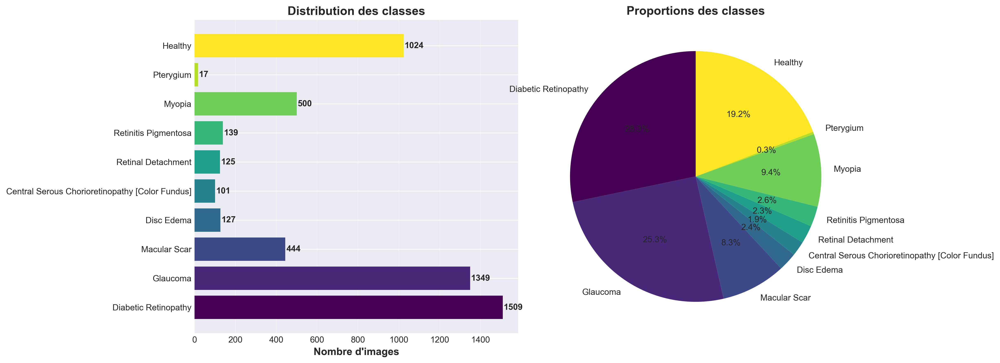
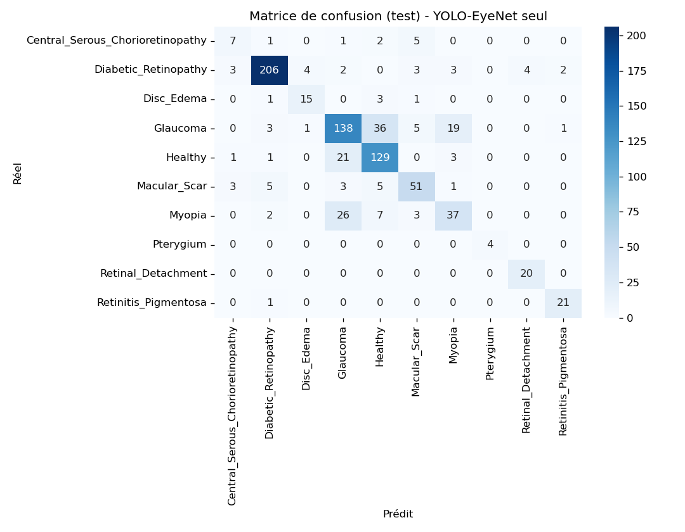

# Eye disease classification from fundus images

Group project for the Deep Learning course of my Master's in Artificial Intelligence, done with Amos Nioule.

The goal was to classify retinal (fundus) images into 10 classes: healthy eyes and 9 diseases, from very common ones like diabetic retinopathy and glaucoma to very rare ones like pterygium. We fine-tuned YOLO classification models. We also trained a convolutional autoencoder, and tested whether combining its features with YOLO's helps.

## Data

[Eye Disease Image Dataset](https://data.mendeley.com/datasets/s9bfhswzjb/1) (Mendeley Data): 5,335 fundus images collected in two eye hospitals in Bangladesh.



The dataset is very imbalanced. Diabetic retinopathy has 1,509 images, pterygium only 17, so the test set has 4 pterygium images.

## Pipeline

1. **Split** the original images 70 / 15 / 15 per class (train / validation / test), before anything else.
2. **Preprocess**: resize to 640×640, then CLAHE on the luminance channel to even out the very different brightness levels between images.
3. **Augment the training set only**, much more for rare classes: ×50 for pterygium, ×10–12 for disc edema, retinal detachment and central serous chorioretinopathy, nothing for the three largest classes. The training set goes from 3,729 to 8,262 images. Validation and test keep only original images.
4. **Fine-tune YOLO classification models**:
   - YOLOv8s-cls and YOLO11s-cls with default settings;
   - "YOLO-EyeNet", which is YOLO11s-cls trained longer with a lower learning rate, AdamW and dropout.
5. **Train a convolutional autoencoder** on the 4 largest classes. Its loss combines reconstruction (MSE + SSIM) with a small classification term, so that the 512-dimension latent space keeps class information.
6. **Fusion**: concatenate YOLO-EyeNet's embedding with the autoencoder's, and classify them with an MLP.

## Results

All scores are on the 810 test images, which none of the models saw during training. The split was checked on file names, including the augmented copies.

| Model | Accuracy | Macro F1 |
| --- | --- | --- |
| YOLOv8s-cls | 77.8% | – |
| YOLO11s-cls | 77.3% | – |
| **YOLO-EyeNet** | **77.5%** | **0.771** |
| MLP on YOLO-EyeNet embeddings | 76.3% | 0.763 |
| MLP on autoencoder embeddings | 52.4% | 0.446 |
| Fusion YOLO-EyeNet + autoencoder | 72.5% | 0.752 |

YOLOv8s and YOLO11s are scored with Ultralytics' own evaluation (YOLO-EyeNet gets 77.4% that way), the other rows with `src/evaluate_fusion.py`. The three YOLO models end up within half a point of each other. Top-5 accuracy is above 99% for all of them, so the right class is almost always among the first guesses.

**The fusion does not help.** Its embeddings bring much less information than YOLO's (52% accuracy on their own). Adding them to the YOLO embeddings makes the MLP slightly worse, not better.

The fusion MLP is trained on the training set, its best epoch is chosen on validation, and it is scored once on test.

### Where the model struggles



Most errors are between glaucoma, healthy eyes and myopia. All three are judged largely on the look of the optic disc, and they make up most of the confusion matrix outside the diagonal. Diabetic retinopathy (F1 0.92), retinal detachment and retinitis pigmentosa (F1 0.91) are well recognized. Central serous chorioretinopathy is the weakest class (F1 0.47, on 16 test images).

The scores on rare classes rely on very few test images (4 to 22), so they could change a lot with a different split.

### The autoencoder as an anomaly detector

The autoencoder only saw 4 classes during training. Pterygium images reconstruct much worse than the classes it saw: mean MSE 0.015 against about 0.002. That makes sense: pterygium is a growth on the surface of the eye, not a retinal disease, so its images look very different. Retinal detachment is also higher on average. The other unseen diseases reconstruct almost as well as the training classes, though, so reconstruction error alone is not a reliable way to flag rare diseases here.

## Project structure

```
src/
    config.py                   paths and class names
    explore_dataset.py          class counts, image properties, examples
    preprocess.py               split + resize + CLAHE
    augment.py                  targeted augmentation of the training set
    to_yolo_format.py           folder layout expected by YOLO
    train_yolo.py               YOLOv8s, YOLO11s and YOLO-EyeNet
    prepare_autoencoder_data.py
    autoencoder.py              model and training
    evaluate_fusion.py          comparison of the models on the test set
results/                        figures and detailed scores (resultats.json)
```

## Run it

```bash
pip install -r requirements.txt
```

Download the dataset and put its `Original Dataset` folder inside `Eye Disease Image Dataset/` at the root of the repository. Then, from the root:

```bash
python src/explore_dataset.py
python src/preprocess.py
python src/augment.py
python src/to_yolo_format.py
python src/train_yolo.py eyenet          # or yolov8s, yolo11s
python src/prepare_autoencoder_data.py
python src/autoencoder.py
python src/evaluate_fusion.py
```

Training is much faster on a GPU. The evaluation script only runs the trained models and takes about 15 minutes on CPU.

On Windows with Anaconda, if Python stops with `OMP: Error #15`, run `set KMP_DUPLICATE_LIB_OK=TRUE` first (`$env:KMP_DUPLICATE_LIB_OK="TRUE"` in PowerShell).

## Tools

Python, PyTorch, Ultralytics YOLO, OpenCV, Albumentations, scikit-learn, matplotlib, seaborn.

---

## Résumé en français

Projet de groupe du cours de Deep Learning (Master IA), réalisé avec Amos Nioule. On classe des images de fond d'œil en 10 classes (œil sain et 9 maladies) à partir d'un dataset très déséquilibré.

Le pipeline comprend :
- un découpage train / validation / test fait avant toute augmentation ;
- un prétraitement CLAHE ;
- une augmentation ciblée des classes rares ;
- le fine-tuning de modèles YOLO de classification ;
- un autoencodeur convolutionnel ;
- une fusion des deux représentations.

Le meilleur modèle, YOLO-EyeNet, atteint 77,5 % d'accuracy sur les 810 images de test (F1 macro 0,77). Les erreurs se concentrent entre glaucome, œil sain et myopie.

La fusion avec l'autoencodeur n'améliore pas le résultat (72,5 %).
